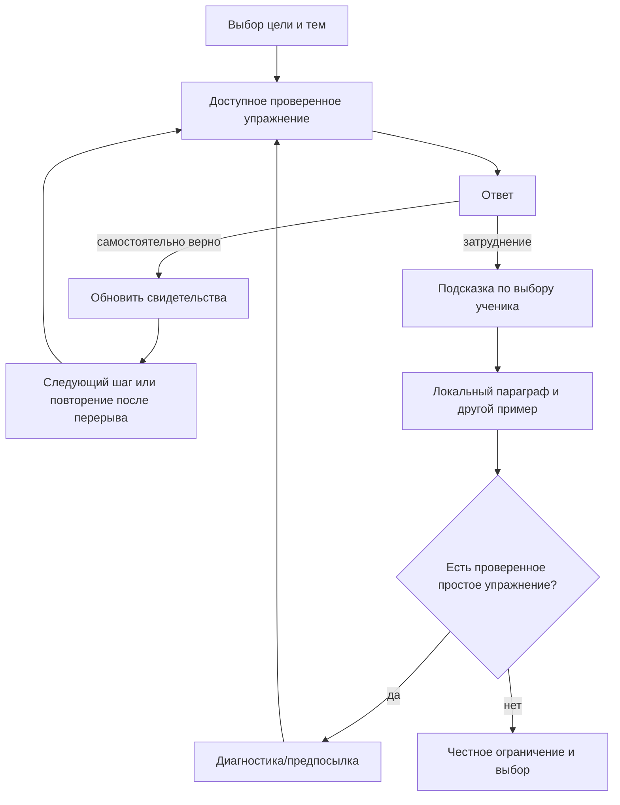

# Набросок адаптивного механизма

27.10.2026. **Предложение для следующего этапа**, а не описание уже готового
персонального маршрута. Рабочая основа: [статусы и прогресс](current-learning.md),
[параграфы и очередь практики](knowledge-and-order.md).

## Идея и границы

Два режима используют один проверенный набор материалов и общую проверку
ответов. Обычный — самостоятельный выбор темы и практика; адаптивный —
объяснимый выбор следующего действия по результатам. Настройки ученика
ограничивают рекомендации, но не переписывают его результаты.

Научная гипотеза: при одинаковом времени и материале предлагаемая политика
«ошибка → подходящая помощь → диагностическое упражнение → повторение после
перерыва» улучшает результат отложенной проверки относительно обычной
тренировки. Адаптивность сама по себе не новое изобретение; проверять нужно
конкретную политику выбора и её отличие от базового режима.

## Что уже есть, что ещё необходимо

| Основа | Сейчас | Следующий шаг |
|---|---|---|
| Ответы и позиции | Исторически проверенные ответы, официальный проект-2027, флаги неполноты | Предметная приёмка фиксированного учебного модуля |
| Статусы | Предварительная политика по 27 группам | Разметка мелких skillId и предпосылок |
| Порядок практики | Повторение, трудности, ошибки, новое; есть перемешивание | Планировщик действий с объяснением причины |
| Подсказка | Общая стратегия по группе, учитывается assisted | Несколько уровней помощи под конкретное умение |
| Правило | Локальные ссылки на четыре черновика | Нормативный справочник и предметно проверенные параграфы |
| Более простые задания | Отдельного подтверждённого пула нет | Авторские диагностические упражнения, сложность и review |
| Назначение и события | Локальный учёт помощи, событий и версии карточки | Контракт v2 для переходов, уровней помощи и настроек |

## Настройки ученика

- Обычная / адаптивная тренировка; самостоятельный выбор имеет приоритет.
- Выбранные темы/цель: освоить новое, разобрать трудности, повторить.
- Бюджет занятия: например 5, 10 или 20 минут — варианты интерфейса для проверки.
- Разрешить ли предложения теории и более простых упражнений. Отказ не
  означает ошибку и не понижает статус.

Нельзя обещать уровень сложности, пока он не размечен редактором. Настройка
режима не меняет строгость проверки ответа или числитель закрепления.

## Контракт планировщика

Вход: now; версия политики; настройки; редакторский граф навыков; допустимые
пулы упражнений и правил; история попыток с assisted и версией материала;
самооценка отдельно; последнее действие и текущая очередь.

Выход — одно действие с основанием:

```text
kind: practice | review | hint | rule | diagnostic | choose | unavailable
skillId, cardId?, paragraphId?
reasonCode, reasonText
alternatives[]
policyVersion
```

Планировщик — чистая функция: одинаковые входы дают одинаковый выбор. Он не
пишет историю и не вызывает модель. Сохранение события и отображение делает
вызывающий код. Для новых событий потребуется новая версия экспортного
контракта; нельзя незаметно дописывать поля в строгий формат v1.

## Выбор следующего шага

```text
если ученик явно выбрал допустимую тему/карточку:
    выполнить выбор, при необходимости предложить предпосылку
иначе если есть незавершённый разбор ошибки:
    предложить следующий согласованный уровень помощи
иначе если в выбранной области наступил срок повторения:
    выбрать доступное упражнение с самой ранней датой повторения
иначе если есть слабое умение с доступной диагностикой:
    предложить диагностику или практику по этому умению
иначе:
    предложить ещё не пробованное умение с доступными предпосылками
если подходящего проверенного материала нет:
    объяснить ограничение и дать выбор другой темы
```

Внутри пула: не встречавшиеся в текущем занятии → дольше не решавшиеся →
фиксированный редакторский порядок. После трёх автоматических упражнений
одного умения предложить смену/перерыв; при отсутствии альтернатив не
зацикливаться. Ученик вправе продолжить тему явно.

## Действие после ошибки

1. Сначала предложить короткую подсказку о способе проверки, без ответа.
2. При повторном затруднении — конкретный локальный параграф и пример,
   отличный от текущего упражнения.
3. Если есть проверенный диагностический пул — более простое упражнение
   на нужную предпосылку или один отдельный шаг.
4. После успешной самостоятельной практики — другое задание по тому же
   умению; затем повторение после перерыва по политике статусов.

Одна неверная строка в комплексном задании не позволяет автоматически
определить ошибочное правило. Например, неверный набор рядов про приставки
не доказывает, что ученик не знает именно И/Ы. При отсутствии разметки и
диагностики говорить только о трудности группы. Если простого упражнения
нет, не называть случайное задание «более простым» и не генерировать
непроверенный учебный ответ на лету.

После согласования автора правило не маркирует помощь. Подсказка, ответ и разбор
маркируют assisted. Завершённое решение с помощью получает 0; без помощи — 1/n.
Незавершённая попытка увеличивает охват, но не обновляет оценку. Самооценка «непонятно» может повлиять на предложение помощи,
но не подменяет системный статус.



## Как проверять эффект

До эксперимента зафиксировать версию модуля, приёмку учителем, политику,
исходную и отложенную проверку на отдельных заданиях, бюджет времени и
метрики. Сравнивать обычный и адаптивный режимы при сопоставимом исходном
уровне. Основной результат — отложенное самостоятельное решение новых
задач на те же умения; скорость и удовлетворённость — дополнительные.

Непроверенные разборы и неполные условия не выдаются участникам. Наличие
answer_verify само по себе не является допуском к школьному эксперименту.
Сейчас нет завершённого исследования, статистических выводов или
доказанной эффективности числового профиля.

## Порядок реализации

1. Предметно принять небольшой модуль, разметить skillId, предпосылки и
   диагностические формы; связать правила по постоянным id.
2. Развивать чистую recommendPractice(input) в отдельном модуле; покрыть причины выбора и отсутствие пула.
3. Добавить переключатель режима и карточку рекомендации «почему это».
4. Версионировать события и настройки, обеспечить перенос/воспроизведение.
5. Провести проверку удобства и пилот на принятом модуле; затем исследование.

## Первая реализованная часть

В html/js/adaptive.js добавлен чистый recommendPractice(input); он вызывается
напрямую из app.js. Это ограниченный слой выбора карточки,
а не весь описанный выше граф, уровни помощи и исследовательский режим.

Вход уже вычисленных статусов содержит now-зависимые проекции; сам планировщик
не читает часы и не использует случайность без входного seed. Выбирается
допустимая карточка внутри выбранной группы, исключая текущую и, когда есть
альтернативы, последние три в пределах текущего 30-минутного интервала. Возвращаются cardId, reasonCode, reasonText,
альтернативы и версия политики. «Дальше» в порядке «Для практики» использует
этот сервис и показывает причину; старт занятия тоже использует рекомендацию.
Порядки «По позициям ЕГЭ» и «Перемешать» остаются явным выбором пользователя.

При отсутствии допустимого материала выводится причина; система не подставляет
непроверенную карточку ради продолжения. Приоритет: срок повторения, ручное
«повторить позже», последняя ошибка, новое, продолжение практики. Это не
диагноз конкретной ошибки внутри комплексной задачи.

Избранное не влияет на оценку или приоритет. Будущая настройка «только избранное»
будет ограничивать пул по явному выбору ученика; она не должна повышать статус
или менять общий знаменатель прогресса. Упрощённые задания, граф зависимостей,
полный адаптивный режим и разметка мелких навыков по-прежнему не готовы.

## Место упражнений проще ЕГЭ

Целевой механизм включает не только перестановку исходных карточек, но и
проверенные атомарные упражнения: одно написание, один разбор или один шаг
перед комплексной задачей. Успех на них подтверждает соответствующее мелкое
умение, а не автоматически всю группу ЕГЭ. Сейчас отдельный пул ещё не создан.

Для исследования политики маршрута обе группы участников должны иметь доступ
к одинаковым материалам, включая простые формы. Различается способ выбора
следующего шага; иначе результат нельзя приписать только адаптивной очереди.
Если сравнивается весь комплекс «маршрут + новые упражнения», это другая
гипотеза и должно быть явно зафиксировано в методике.
