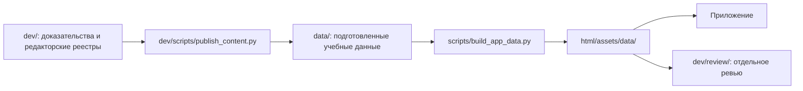

# Карта проекта

Актуально на **29.10.2026**, ветка `feat/ege-1-6-priority`.
Основная часть собирается и работает без `dev/`.

```text
rus-flash/
├── README.md                       Сборка, запуск и деплой
├── .github/workflows/               Публикация только html/
├── data/
│   ├── card_*.json                  2140 исходных карточек
│   ├── exam_profile.json            Названия позиций ЕГЭ
│   ├── assessment_policy.json       Действующие ограничения автопроверки
│   ├── sources/                     PDF и статьи, доступные в приложении
│   └── knowledge/
│       ├── card_support.json        Готовые подсказки, связи и хеши контента
│       ├── paronyms.json            Опубликованные значения и сравнения
│       ├── dictionary_sources.json  Файлы учебных источников и их хеши
│       ├── handbook.json            Короткие правила
│       ├── source_registry.json     Источник для генерации параграфов
│       ├── sources/                 FB2 и необходимые поправки к источнику
│       ├── stress-list.json         Орфоэпический список
│       └── paronym_inventory.json   Формы слов и состав групп
├── html/
│   ├── index.html                   Оболочка приложения
│   ├── css/                         Стили интерфейса
│   ├── js/                          Работа приложения в браузере
│   └── assets/
│       ├── brand/                   Логотип
│       └── data/                    Генерируется, в Git не хранится
├── scripts/                         Только сборка и проверка публикации
│   ├── install.sh
│   ├── build_app_data.py
│   ├── card_data.py
│   ├── dictionary_data.py
│   ├── exam_2027.py
│   ├── handbook_fb2.py
│   ├── paronym_inventory.py
│   └── check_pages_artifact.py
└── dev/                             Вся вспомогательная часть
    ├── README.md
    ├── docs/                        Планы, спецификации, литература, баги,
    │                                журналы, ревью и справочные оригиналы
    ├── data/                        Редакторские реестры и аудит
    ├── scripts/                     ФИПИ, подготовка источников, публикация
    │                                готовых данных и сборка страницы ревью
    ├── tests/                       Все проверки
    ├── review/                      Отдельная страница ревью с просмотром сайта
    └── requirements.txt             Только зависимости разработки
```

## Веб-модули

`app.js` управляет экранами и hash-навигацией; `ui.js` — разметкой и иконками;
`data.js` — загрузкой; `store.js` — локальным состоянием и попытками;
`assessment.js` — ответами; `learning.js` — оценками; `settings.js` — настройками;
`adaptive.js` и `bank-order.js` — подбором и сортировкой; `progress.js` — дашбордом;
`progress-transfer.js` — переносом истории. `knowledge.js`, `paronyms.js`,
`lexical-norms.js`, `stress-list.js` показывают учебные материалы.

CSS разделён на базовые элементы, главную, банк/карточку, справочник/историю,
прогресс и адаптацию. Порядок импортов сохранён. Отладочного кода и стилей
в этих модулях больше нет.

## Направление зависимостей



Обратной зависимости от production к `dev/` нет. Скрипты получения новых
заданий, проверки ФИПИ, извлечения PDF/MOBI и тесты не нужны пользователю сайта.
При изменении учебных материалов обновляются подготовленные данные через
редакторский инструмент, затем запускается штатная сборка.

[Проверка разделения](production-separation.md), [инструмент ревью](review-debug.md).
