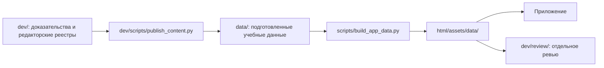

# Карта проекта

Обновлено **18.11.2026**.
Основная часть собирается и работает без `dev/`.

```text
rus-flash/
├── README.md                       Сборка, запуск и деплой
├── .github/workflows/               Публикация только html/
├── data/
│   ├── card_*.json                  2140 исходных карточек
│   ├── exam_profile.json            Названия позиций ЕГЭ
│   ├── assessment_policy.json       Действующие ограничения автопроверки
│   ├── sources/                     PDF и статьи, доступные в приложении
│   └── knowledge/
│       ├── card_support.json        Готовые подсказки, связи и хеши контента
│       ├── paronyms.json            Опубликованные значения и сравнения
│       ├── dictionary_sources.json  Файлы учебных источников и их хеши
│       ├── handbook.json            Короткие правила
│       ├── source_registry.json     Источник для генерации параграфов
│       ├── sources/                 FB2 и необходимые поправки к источнику
│       ├── stress-list.json         Орфоэпический список
│       └── paronym_inventory.json   Формы слов и состав групп
├── html/
│   ├── index.html                   Оболочка приложения
│   ├── css/                         Стили интерфейса
│   ├── js/                          Работа приложения в браузере
│   └── assets/
│       ├── brand/                   Логотип
│       └── data/                    Генерируется, в Git не хранится
├── scripts/                         Только сборка и проверка публикации
│   ├── install.sh
│   ├── build_app_data.py
│   ├── card_data.py
│   ├── dictionary_data.py
│   ├── exam_2027.py
│   ├── handbook_fb2.py
│   ├── paronym_inventory.py
│   └── check_pages_artifact.py
└── dev/                             Вся вспомогательная часть
    ├── README.md
    ├── docs/                        Планы, спецификации, литература, баги,
    │                                журналы, ревью и справочные оригиналы
    ├── data/                        Редакторские реестры и аудит
    ├── scripts/                     ФИПИ, подготовка источников, публикация
    │                                готовых данных и сборка страницы ревью
    ├── tests/                       Все проверки
    ├── review/                      Отдельная страница ревью с просмотром сайта
    └── requirements.txt             Только зависимости разработки
```

## Веб-модули

| Что делает ученик | Где искать реализацию |
|---|---|
| Открывает карточку и отвечает | `app.js` выбирает экран, `data.js` загружает карточку и определяет тип ответа, `assessment.js` сверяет ввод с эталоном. |
| Смотрит прогресс и продолжает практику | `store.js` записывает попытки, `learning.js` рассчитывает оценки по настройкам, `bank-order.js` задаёт порядок, `adaptive.js` рекомендует следующую карточку. |
| Переносит историю карточек | `progress-transfer.js` проверяет файл и объединяет записи. |
| Решает учебный вариант | `exam.js` подбирает комплект и считает баллы. `exam-page.js` управляет экраном и отдельно сохраняет прохождение. `exam-theory.js` содержит теорию по номерам. |
| Открывает справочник | `knowledge.js` выбирает раздел, `data.js` загружает материалы. Общие функции показа текста находятся в `ui.js`. |

## Направление зависимостей



Обратной зависимости от production к `dev/` нет. Скрипты получения новых
заданий, проверки ФИПИ, извлечения PDF/MOBI и тесты не нужны пользователю сайта.
При изменении учебных материалов обновляются подготовленные данные через
редакторский инструмент, затем запускается штатная сборка.

[Проверка разделения](production-separation.md), [инструмент ревью](review-debug.md).
