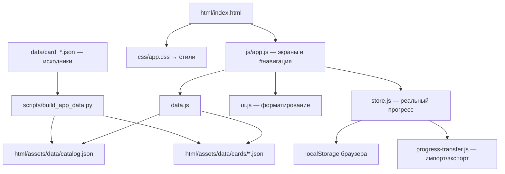

# Карта проекта и веб-модуля

Актуально на **26.10.2026**, ветка `feat/slovo-za-slovo`.
Приложение статическое: в браузере работают HTML/CSS/JavaScript,
Python нужен для подготовки данных и проверки комплекта публикации.

## Весь проект

```text
rus-flash/
├── README.md                         Запуск и обзор
├── fipi_notes.md                     Заметки о ФИПИ
├── .gitignore                        Исключения, включая генерируемые данные
├── data/                             Исходные учебные данные
│   ├── card_*.json                    2140 карточек
│   ├── ege_specification_mapping.json Справочник прежней классификации
│   ├── ege_2027_positions.json        Профиль официального проекта ФИПИ
│   ├── content_review_overrides.json Противоречия и ограничения материала
│   └── knowledge/handbook.json        Локальные параграфы-черновики
├── html/                             Публикуемый сайт — подробнее ниже
├── scripts/                          Подготовка и проверки
│   ├── install.sh                    Штатная сборка
│   ├── build_app_data.py             Генерация данных браузера
│   ├── exam_2027.py                  Сопоставление позиций по содержанию
│   ├── audit_verified_cards.py       Реестр и лог изменений позиций
│   ├── check_pages_artifact.py       Комплектность публикации
│   ├── generate_manifest.py          Классификатор и служебный манифест
│   ├── parse_fipi_missing.py          Загрузка ФИПИ
│   ├── verify_answers_fipi.py         Проверка ответов по ФИПИ
│   └── restore_fipi_highlights.py     Восстановление выделений
├── tests/                            Браузерные проверки
│   ├── ui_smoke.py                   Основные функции
│   ├── composed_home_smoke.py        Главная на пяти ширинах
│   ├── progress_transfer_smoke.py    Импорт и экспорт
│   └── pages_smoke.py                Работа под префиксом /rus-flash/
├── docs/                             Спецификация, план, источники и журнал
└── .github/workflows/
    └── deploy-pages.yml              Ручная публикация
```

## Веб-часть html/

```text
html/
├── index.html                        Общая оболочка всех экранов
├── css/
│   ├── app.css                       Порядок подключения семи стилевых файлов
│   ├── base.css                      Переменные, навигация, общие элементы
│   ├── study.css                     Базовые блоки главной
│   ├── bank-card.css                 Банк, текст, условие, варианты, ответы
│   ├── history-knowledge.css         История, справочник, диалоги, уведомления
│   ├── responsive.css                Общая адаптация и reduced-motion
│   ├── progress.css                  Демонстрационный дашборд
│   └── home.css                      Итоговая композиция, notes, постер, логотип
├── js/
│   ├── app.js                        Экраны, hash-навигация и обработчики
│   ├── ui.js                         Иконки, числа, безопасная разметка
│   ├── data.js                       Загрузка и адаптация исходной модели
│   ├── store.js                      Попытки, метки, назначения, перенос
│   ├── assessment.js                 Проверка типов ответа
│   ├── learning.js                   Оценки и статусы карточек/групп
│   ├── settings.js                   Коэффициенты, сроки, порог; экран #settings
│   ├── adaptive.js                   Пилот подбора с причиной
│   ├── bank-order.js                 Три порядка выдачи
│   ├── hints.js                      Стратегии-подсказки
│   ├── progress.js                   Реальный дашборд
│   ├── progress-transfer.js          Проверка и объединение JSON v1/v2
└── assets/
    ├── brand/slovo-za-slovo-school.png Логотип
    └── data/                         Генерируется; не хранится в Git
        ├── catalog.json              Краткие записи и метаданные
        ├── handbook.json             Копия локального справочника
        └── cards/*.json              Полные карточки для загрузки по одной
```

CSS разделён без перестановки каскада: сначала базовые стили экранов,
затем общая адаптация, демо и уточнения выбранной композиции. Изменение порядка
импортов может изменить оформление. Настройки телефона есть и в файлах
компонентов, поэтому responsive.css не является единственным местом адаптации.

## Поток данных



data/ — источник истины. Файлы assets/data/cards/ содержат те же карточки,
сериализованные компактно; catalog.json — производная сводка с классификацией.
Копии нужны, потому что публикуется только html/. Их не редактируют вручную:
после изменений исходников выполняют `bash scripts/install.sh`.

Сборка не обращается к ФИПИ и не исправляет ответы. Сетевые утилиты запускаются
отдельно; TLS-проверка включена; сетевой доступ необходимо проверить перед
доверенной подготовкой материалов. Классификация остаётся неподтверждённой
для ЕГЭ-2027.

## Где менять поведение

| Изменение | Основное место |
|---|---|
| Шапка, оболочка, диалог | html/index.html |
| Состав экрана и переходы | html/js/app.js |
| Цвета и компоновка | Нужный файл html/css/, порядок в app.css |
| Разметка исходного текста | html/js/ui.js: rich() |
| Учебное содержимое | data/card_*.json, затем сборка |
| Преобразование старой модели | html/js/data.js: adaptCard() |
| Локальная история и отметки | html/js/store.js |
| Политика импорта | html/js/progress-transfer.js |

Старые legacy.html, dashboard.html, stats.html, ezhik.png и генераторы HTML
удалены из действующего проекта; история доступна в Git. В папке от прежнего
checkout могут оставаться игнорируемые html/cards/card_*.html и
html/cards_manifest.js. Текущему приложению они не нужны и обычная сборка
их больше не создаёт. Отдельный generate_manifest.py сохранён для служебной
проверки ФИПИ по группам.

Обновление 27.10.2026: [официальная таблица позиций](ege-2027-card-mapping.md),
[исправления](correction-log.md), [реальные статусы и подсказки](current-learning.md).
Текущий прогресс работает по укрупнённым группам; детализация навыков,
полный адаптивный маршрут и предметная приёмка остаются следующими этапами.
